  

### Hi, I'm Andrei 👋

I build mobile apps and the backends behind them: a fitness app that's live on both app stores, a computer-vision system for athletes, and a daily trivia game. My work lives in private repos, so here's what's in them. I'm happy to walk through any of it.

#### 🏋️ Altus: live on the App Store and Google Play
A fitness app with workout and run tracking, a companion watch app, progress analytics and subscriptions.
`Flutter` `Dart` `Supabase` `Firebase` `RevenueCat`

#### 🧠 Kinetiq Science
Early warning for athletes, based on how consistent their movement mechanics are and how much load they're taking on. A Mac Mini on site runs the vision pipeline, detecting the athlete with YOLO and tracking their pose with ViTPose. It streams live pose data to coaches on an iOS app, where they label sessions to build a training dataset that keeps improving the model.
`Python` `FastAPI` `YOLO` `ViTPose` `React Native` `WebSockets` `Supabase`

There's also the product website and admin dashboard: `Next.js` `TypeScript` `Tailwind` `Supabase` `Vercel`

#### 🔗 LinkedUp
A daily chain-of-clues trivia game for iOS, Android and web, where the last word of each answer starts the next one. It has daily challenges, an archive, a pass-the-phone party mode for up to 12 players, and subscriptions.
`Expo` `React Native` `TypeScript` `Supabase` `Redis` `RevenueCat`

🐺 That's Luka, my husky. Each pine is one of my last 30 days, and busier days grow bigger trees. The more I ship that week, the faster Luka wags his tail. If I go quiet for 3 days, he naps in the snow.
